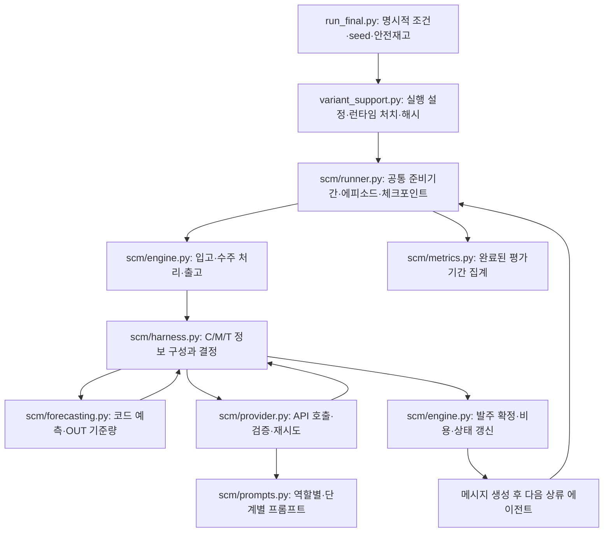

# 코드 설명

이 문서는 `SCM_LLM_Agent_Harness` revision 4의 실행 코드가 무엇을 하는지 설명합니다. 실행 명령은 [README](../README.md), 조건과 수치는 [실험 설계](EXPERIMENT_DESIGN.md), 게시본의 보존·검증 범위는 [재현성 기록](REPRODUCIBILITY.md)을 참고하세요. 물류 환경과 LLM 하네스는 분리되어 있습니다. 물류 상태·비용은 환경 코드가 계산하고, LLM은 허용된 정보를 받아 예측·방법 선택·최종 발주·메시지를 담당합니다.

## 1. 실행 흐름과 파일 구조

| 파일 | 역할 |
|---|---|
| [`run_final.py`](../run_final.py) | 권장 실행 진입점. 안전재고를 반드시 명시하고 최종 통합 처치를 적용합니다. |
| [`variant_support.py`](../variant_support.py) | 인자·출력 폴더 검증, 런타임 프롬프트 추가, 소스/설정 해시, 실행 잠금, 동일 실행 재개를 관리합니다. |
| [`run_qmean.py`](../run_qmean.py) | CMT 주문 프롬프트에 추가되는 `Q_base=0` 설명 문장 원문을 보관합니다. |
| [`scm/config.py`](../scm/config.py) | 물류 설정 `SimulationConfig`와 LLM/API 설정 `APIConfig`를 구분합니다. |
| [`scm/registry.py`](../scm/registry.py) | 100개 CMT와 5개 기준조건을 등록합니다. |
| [`scm/engine.py`](../scm/engine.py) | 물리 상태, 수요 생성, 물류 불변식, API 없는 공통 준비기간을 구현합니다. |
| [`scm/harness.py`](../scm/harness.py) | C 입력, 예측 단계, 최종 발주, 메시지 전달, 단계별 실패 처리와 진단 기록을 구현합니다. |
| [`scm/forecasting.py`](../scm/forecasting.py) | LR30·MA30·SES, OUT 기준량, 수량 반올림·하한·상한을 계산합니다. |
| [`scm/prompts.py`](../scm/prompts.py) | 각 역할·단계의 영어 지시문, 목적, 정보 경계, 예측식과 메시지 규칙입니다. |
| [`scm/ownership.py`](../scm/ownership.py) | 입력 필드의 주체·관측 시점·출처 라벨을 만듭니다. 다른 에이전트의 숨겨진 상태를 추가하지 않습니다. |
| [`scm/m2_validation.py`](../scm/m2_validation.py) | M2에 허용되지 않는 수량·계획 표현 등을 제한적으로 검사합니다. 사실성 전체를 검증하는 도구는 아닙니다. |
| [`scm/provider.py`](../scm/provider.py) | OpenRouter 전송, 엄격한 JSON/스키마 검증, 물리적 API 시도 기록, 재시도·예산·경로 확인과 mock입니다. |
| [`scm/runner.py`](../scm/runner.py) | 준비기간 캐시, 에피소드 실행, 체크포인트, 완료/중단 저장과 배치 관리를 담당합니다. |
| [`scm/metrics.py`](../scm/metrics.py) | 완료된 평가자료의 비용·서비스·발주 CV·사용량을 검증하고 집계합니다. |
| [`tests/`](../tests/) | 물류, 입력 경계, 실패·복구, 재개, 지표, CLI 등에 대한 오프라인 검사입니다. |
| [`verification/`](../verification/) | 별도로 보유한 실행 결과를 읽어 검산하는 도구입니다. |

## 2. 공급망과 기간 내 처리 순서

외부 고객 → 소매상 → 도매상 → 유통업자 → 공장 → 외부 공급원의 직렬 구조입니다. **주문과 추가 메시지는 상류로**, **제품은 하류로** 이동합니다. 공장이 외부 공급원에 낸 주문은 별도 생산능력 제한 없이 2기 후 공장에 입고됩니다.

한 기간에는 소매상부터 공장까지 순차 실행합니다. 코드의 중심은 `SupplyChain.begin_agent()` → `Harness.decide()` → `SupplyChain.finish_agent()`입니다.

1. **당기 수주 결정:** 소매상은 고정된 외부 고객 수요를 받습니다. 나머지 단계의 당기 수주는 바로 하류가 이번 기간에 확정한 발주입니다. 추가 메시지도 하류가 발주를 확정한 후 작성한 이번 기간 메시지입니다.
2. **입고와 출고:** 예정된 실제 도착량을 재고에 더합니다. 기존 백로그와 신규 수주를 재고 범위 내에서 처리하고, 남은 재고와 백로그를 계산합니다. 서비스 계산에서는 기존 백로그를 먼저 처리합니다.
3. **발주 전 상태 관측:** `I`, `B`, `P_pre`와 허용된 로컬 이력/통계를 구성합니다. `P_pre`에서는 이번 입고가 빠졌지만 이번 발주는 아직 포함되지 않습니다.
4. **예측과 기준량:** CMT는 T에 따라 별도의 자기 수주 30기 이력으로 예측하고, 코드가 OUT 기준량을 만듭니다. A/N0/N0-G0에는 이 단계가 없습니다. D 두 조건은 각자의 기준식을 사용합니다.
5. **최종 발주:** LLM이 최종 수량을 제안합니다. 일반 조건은 수량을 보정한 뒤 확정합니다. 기준량은 권고값이며 LLM이 다른 주문을 선택할 수 있습니다.
6. **상태·비용 확정:** `P_post = P_pre + Q_final`로 갱신하고 이번 기간의 보유·백로그·발주 비용을 기록합니다. 공장 주문은 2기 후 외부 입고로 예약됩니다.
7. **추가 메시지 작성:** M1은 코드가 확정 상태를 작성합니다. M2/M3/M4는 별도의 호출로 작성합니다. 다음 상류 단계는 확정 주문과 메시지를 받아 1번부터 실행합니다.

메시지 생성은 발주 확정 뒤입니다. 이미 계산된 당기 물류·비용을 되돌리거나 동일 기간 하류 주문을 재협상하지 않습니다. 최상류 공장은 전달할 공급망 에이전트가 없으므로 추가 메시지를 생성하지 않습니다.

### 물류 상태의 뜻

| 필드 | 의미 |
|---|---|
| `D` | 이번 기간 받은 신규 수주. 소매상에서만 외부 고객 수요입니다. |
| `A` | 이번 기간 실제 입고량. 기준조건 이름 A와 별개인 로그 필드입니다. |
| `X` | 이번 기간 실제 출고량입니다. |
| `I` | 입고·기존 백로그·당기 수주 처리 후 남은 실물 재고입니다. |
| `B` | 자기 단계가 바로 하류 고객에게 아직 출고하지 못한 누적 수량입니다. |
| `P_pre` | 자기 단계가 상류에 주문했으나 아직 받지 못한 수량. 이번 입고 차감 후·이번 주문 추가 전입니다. |
| `P_post` | `P_pre + Q_final`입니다. |
| `Q_base_raw` / `Q_base` | 보정 전 / 보정 후 참고 발주량. A/N0/N0-G0의 평가 단계에는 `null`입니다. |
| `Q_final_raw` / `Q_final` | LLM이 제안한 수량 / 환경에서 실제로 실행한 수량입니다. |

`P`는 **운송 중 물량과 상류의 미출고 주문을 모두 포함**합니다. 기간 말에는 각 단계에 대해 `P = 예정된 실물 입고 합 + 바로 상류의 백로그`가 성립하는지 검사합니다. 따라서 `P` 전체가 반드시 2기 후 도착하는 것은 아닙니다. 실제 출고된 물량이 출고 시점에서 2기 후 도착합니다.

### 발주 시점에 알 수 있는 정보

이미 확정된 것은 자기 당기 수주·입고·출고·발주 전 상태, 허용된 자기 이력, 바로 하류의 이번 확정 주문과 허용된 추가 메시지입니다. 다음 기간 고객 수요, 상류의 아직 실행되지 않은 이번 결정, 제공되지 않은 타 단계 재고·백로그와 실제 미래 주문은 관측되지 않습니다. M3의 미래 주문은 확정 수요가 아니라 계획입니다.

## 3. 예측·선택·최종 주문의 정보 경계

하나의 대화가 누적되는 구조가 아닙니다. 각 호출에는 그 단계에 허용된 입력만 새로 구성합니다.

| 단계 | 허용 입력 | 주의점 |
|---|---|---|
| 방법 선택 T3/T4 | 자기 C, 하류 M, 예측 후보 설명 | 별도의 30기 수주 이력이나 후보별 예측 결과를 받지 않습니다. |
| LLM 예측 T0/T1/T3 | 자기 수주 `history_30`, 예측 대상, 필요 시 지정 공식 | C의 재고·백로그, 메시지 M, 다른 단계 설명을 받지 않습니다. |
| 코드 예측 T2/T4 | 자기 수주 최신 30기, 지정/선택된 방법 | LLM 계산 호출을 하지 않습니다. |
| CMT·D 최종 주문 | 자기 C, 하류 M, 당기 `Q_base` | 별도의 30기 원자료나 예측 숫자 두 개를 최종 주문 입력에 그대로 추가하지 않습니다. |
| A·N0·N0-G0 최종 주문 | C0와 당기 D | D는 C.current.D의 반복입니다. 기준량·별도 예측·추가 메시지는 없습니다. |
| M2/M3/M4 생성 | 자기 C, 받은 M, 확정 `Q_final`, `Q_base`, `P_post` | 발주 설명 `rationale`는 입력으로 전달하지 않습니다. |

`rationale`는 제안 수량을 설명하는 연구 로그입니다. 이후 주문이나 다른 에이전트 입력으로 재사용하지 않습니다. M3의 `planning_evidence`도 로그에만 보관하고 상류에는 계획 정수 두 개만 전달합니다. 출처 라벨은 정보의 주체와 시점을 표시하지만 메시지 내용의 진실성을 보장하지 않습니다.

## 4. 실패 처리와 재개

일반 조건은 하나의 논리 작업에 **최초 호출 + 최대 1회 재시도**를 사용합니다. 전송 오류·파싱 오류·스키마 오류·메시지 검사 오류가 같은 재시도 한도를 공유합니다. 별도의 SDK 숨은 재시도는 없습니다.

| 실패 위치 | 재시도 후에도 복구 가능 오류가 남으면 |
|---|---|
| 예측 또는 방법 선택 | 코드 LR30 예측으로 대체합니다. |
| CMT/D 최종 주문 | 현재 `Q_base`를 실행합니다. |
| A/N0 최종 주문 | 현재 수주 D를 정상화하여 실행합니다. |
| 메시지 | 이번 메시지를 `None`으로 처리합니다. 이미 확정된 주문은 유지합니다. |
| N0-G0 주문 | 재시도·반올림·범위 보정·대체 주문 없이 해당 조건·seed를 중단합니다. |

인증·예산·확인할 수 없는 모델 경로와 같은 치명적 실행 오류는 N0-G0의 실험적 중단과 구분합니다. 모든 HTTP 오류가 재시도 가능한 것도 아닙니다. 예를 들어 frozen 코드의 재시도 대상 목록에 HTTP 520은 포함되지 않습니다. 정확한 분기는 [`scm/provider.py`](../scm/provider.py)의 `OpenRouterProvider.ask()`에 있습니다.

각 에이전트 완료 후 체크포인트를 저장하고, API 시도는 JSONL 저널에 따로 기록합니다. 같은 소스·처치·설정의 `--resume`은 체크포인트와 기록된 응답을 사용하여 이미 기록된 동일 호출을 다시 보내지 않도록 설계되었습니다. N0-G0의 최종 중단은 재개해도 다시 시도하지 않습니다. 네트워크 단절로 서버 처리 여부 자체가 알 수 없는 상황까지 중복 과금이 불가능하다고 보장하는 기능은 아닙니다.

## 5. 실행 근거와 결과 파일

| 파일 | 확인하는 내용 |
|---|---|
| `intervention_manifest.json` | 안전재고, CMT Q_base 설명 추가, wrapper와 런타임 소스 해시 |
| `batch_manifest.json` | 배치의 조건·seed·물류 설정·API 설정 |
| `episodes/<조건>__<목적>__seed-<seed>/manifest.json` | 개별 실행 서명과 생성 시점 |
| `checkpoint.json` | 재개를 위한 물류 상태와 다음 실행 위치 |
| `periods.json`, `periods.csv` | 완료 실행의 평가기간별 물류·결정·비용·진단 |
| `api_calls.jsonl` | 물리적 호출 시도, 요청/응답·실패·사용량·실제 경로 기록 |
| `summary.json` | 완료 시 평가 지표 또는 중단 시 실패 정보·부분 지표 |
| `partial_periods.json`, `abort_snapshot.json` | 실험적으로 중단된 실행의 부분 자료. 완료 실행으로 합산하면 안 됩니다. |
| `execution_outcomes.json`, `failures.csv`, `batch_status.json` | 완료·중단·오류와 배치 상태 |

`batch_status.json`에서 `terminal=true`는 모든 실행이 완료 또는 실험적 중단으로 끝났다는 뜻이고, `complete=true`는 모두 정상 완료했다는 뜻입니다. 파일의 존재나 최신 수정 시각만으로 정상 완료를 판단하지 마세요.

프로그램의 동작을 재현할 때는 게시 이후의 문서 수정과 실행 코드 변경을 구분해야 합니다. 실행 일치 여부는 폴더 이름보다 `runtime_source_hash`·설정·수요/준비기간 해시로 확인합니다. [실험 설계의 재현 범위](EXPERIMENT_DESIGN.md#6-실제-r4-실행과-재현-범위)를 함께 참고하세요.
